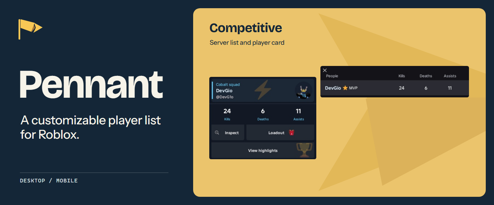
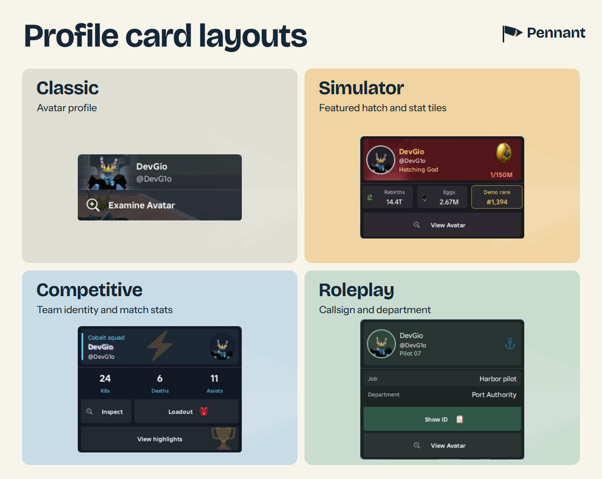
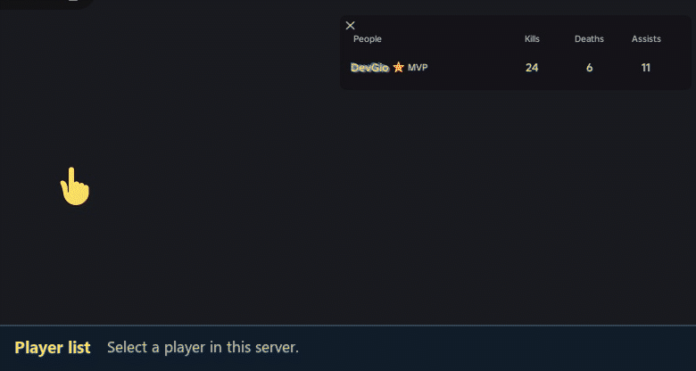
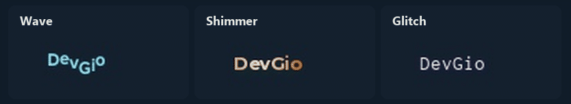
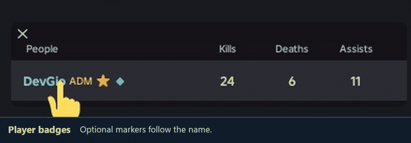
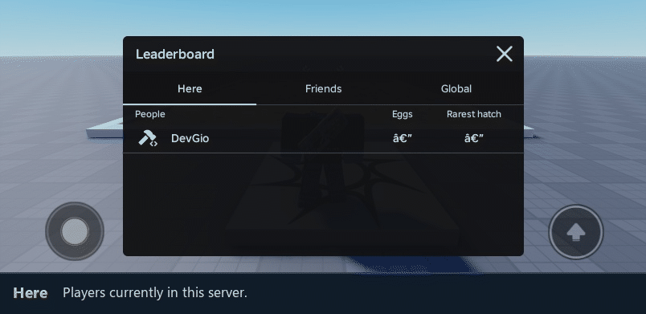

# Pennant



Give a player a gold shimmer, frame their avatar with their rarest hatch, or let a teammate open their loadout from the list. Pennant ships as one Roblox model with four player-card layouts and a single commented `Settings` script. Uses Roblox’s default `leaderstats`.

[Download the Studio model](https://github.com/Ggaming5005/Pennant/releases/latest/download/Roster.rbxm) · [Settings guide](docs/settings.md) · [API reference](docs/api.md) · [Runnable examples](examples)

## Pick a card for your game



The **Simulator** card gives a rare item room for its artwork and odds. **Competitive** puts the team, match stats and actions together. **Roleplay** has space for a callsign, job and department. **Classic** keeps the compact avatar profile.



Buttons can span one column, two columns or a full row. Show different actions on your own card and another player’s card. The round highlights shown above are an example of a game-supplied action.

## Style names and motion



Choose a font and palette for each role. Optional badges sit beside the name and can show a short hover label. In Settings, `Tooltips = false` switches off all badge hints.




Opening and closing have independent settings. Both ship as `Stock`. Choose from 13 presets, including four edge slides, a centered pop and a cartoon bounce. Animations honor the player’s reduced-motion preference.

## Install

1. Download [Roster.rbxm](https://github.com/Ggaming5005/Pennant/releases/latest/download/Roster.rbxm) and insert it into `ReplicatedStorage`. The instance is named `Roster`.
2. In a LocalScript in `StarterPlayerScripts`, start the module.

```luau
local Roster = require(game:GetService("ReplicatedStorage"):WaitForChild("Roster"))
local list = Roster.Start()
```

3. Open **ReplicatedStorage → Roster → Settings**. For a simulator with a playful entrance, start with these settings and press Play.

```luau
return {
    Preset = "Simulator",
    Motion = {Open = "CartoonBounce", Close = "Fade"},
}
```

**Desktop:** Tab toggles the custom list. **Mobile:** Roblox’s dropdown opens its built-in leaderboard on the tested client. Connect `list:SetOpen(true)` to your game’s existing menu to open the custom touch layout.

## Optional Friends and Global tabs



In the sample, Rowan has 68 eggs. That places Rowan fourth overall and first among the viewer’s friends. Try it with the [sample board](examples/rankings.server.luau) and [hatch settings](examples/hatch-settings.luau). The names and scores in this recording are fixtures.

## Tests and source

The release was checked in Studio’s desktop and phone playtests. The repository includes the same UI test, plus repeatable tests for the packaged model and ranking behavior. [Test results and commands](docs/testing.md) · [Module source](src/Roster.luau) · [Default Settings](src/Settings.luau)

Pennant is released under the [MIT License](LICENSE). [Roblox UI and asset credits](docs/credits.md)
