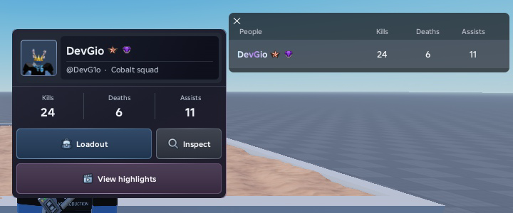
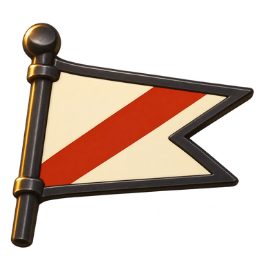
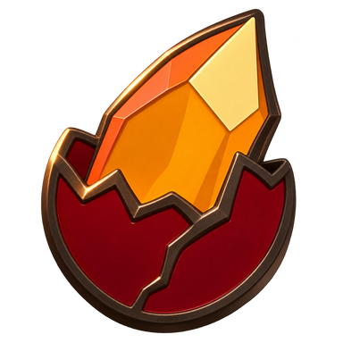
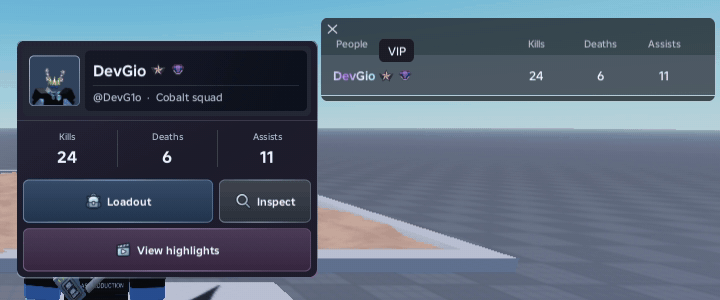
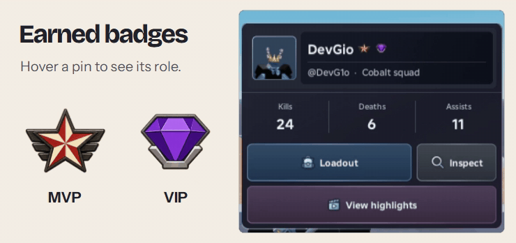
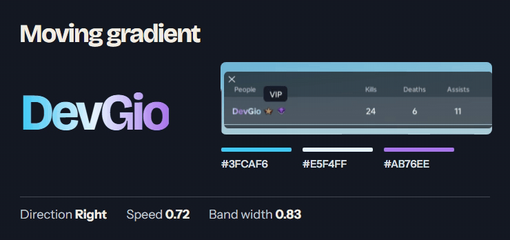
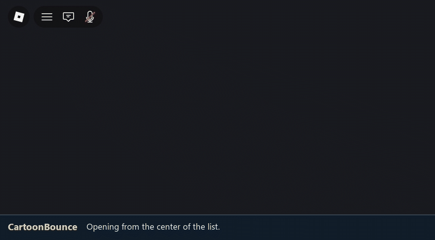
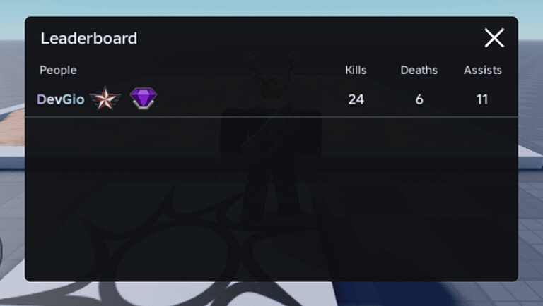

# Pennant



Give a player a gold shimmer, feature their rarest hatch, or let a teammate open their loadout from the list. Pennant ships as one Roblox model with five player-card layouts and a single commented `Settings` script. Uses Roblox’s default `leaderstats`.

[Download v0.2.0 for Studio](https://github.com/Ggaming5005/Pennant/releases/download/v0.2.0/Roster.rbxm) · [Settings guide](docs/settings.md) · [API reference](docs/api.md) · [Runnable examples](examples)

**See v0.2.0 in action.** [Moving name gradient](media/moving-gradient.gif) · [MVP and VIP hovers](media/earned-badges.gif) · [Phone card and Back](media/mobile-profile.gif)

## Pick a card for your game

The **Simulator** card gives a rare item room for its artwork and odds. **Competitive** shows a player's name, @handle and team alongside the match stats your game tracks. **Profile** gives the player a banner, framed portrait and an optional bio. **Roleplay** has space for a callsign, job and department. **Classic** keeps the compact avatar profile.

| Classic | Simulator | Competitive | Roleplay |
| :---: | :---: | :---: | :---: |
|  |  |  |  |

The four transparent [template icons](media/icons) are sized for cards, badges and action buttons. Use `TemplateIcons = false` to turn off the preset emblem.

Competitive centers each stat label above its value. Set `Columns` to show the stats that decide a match in your game. The backpack opens Loadout, the magnifier opens Inspect, and the clapperboard opens your game's highlights. Profile uses the full-width banner and nine-slice border. [Match card settings](docs/settings.md#competitive-match-stats) · [Biography setup](docs/profile.md) · [Editable artwork](media/profile-source)



Buttons can span one column, two columns or a full row. Show different actions on your own card and another player’s card. Connect `OnHighlights` to the recap your game provides.

## Style names and motion


Choose a font and palette for each role. Optional badges sit beside the name and can show a short hover label. In Settings, `Tooltips = false` switches off all badge hints.



MVP, VIP, Creator, Moderator, Champion and Founder share a single badge sheet. Your game supplies the role or achievement for each assignment. [Badge examples and PNG pack](docs/settings.md)

Use `MovingGradient` to move your colors across a name. This example goes from ice blue through lavender and back across the letters. The same palette stays visible when the player enables reduced motion.



```luau
-- Inside the Settings table
StylePlayer = function(player)
    return {
        NameTag = {
            Font = Enum.Font.BuilderSansBold,
            Effect = {
                Preset = "MovingGradient",
                Colors = {Color3.fromHex("58D3F2"), Color3.fromHex("DED8FF"), Color3.fromHex("A674E9")},
                Direction = "Right", BandWidth = 0.85, Speed = 0.65,
            },
        },
    }
end,
```




Opening and closing have independent settings. Both ship as `Stock`. Choose from 13 presets, including four edge slides, a centered pop and a cartoon bounce. Animations honor the player’s reduced-motion preference.

## Install

1. Download [Roster.rbxm](https://github.com/Ggaming5005/Pennant/releases/download/v0.2.0/Roster.rbxm) and insert it into `ReplicatedStorage`. The instance is named `Roster`.
2. In a LocalScript in `StarterPlayerScripts`, start the module.

```luau
local Roster = require(game:GetService("ReplicatedStorage"):WaitForChild("Roster"))
local list = Roster.Start()
```

3. Open **ReplicatedStorage → Roster → Settings**. For a simulator with a playful entrance, start with these settings and press Play.

```luau
return {
    Preset = "Simulator",
    Motion = {Open = "CartoonBounce", Close = "Fade"},
}
```

**Desktop:** Tab toggles the custom list. **Mobile:** Roblox’s dropdown opens its built-in leaderboard on the tested client. Connect `list:SetOpen(true)` to your game’s existing menu to open the custom touch layout.



## Optional Friends and Global tabs


In the sample, Rowan has 68 eggs. That places Rowan fourth overall and first among the viewer’s friends. Try it with the [sample board](examples/rankings.server.luau) and [hatch settings](examples/hatch-settings.luau). The names and scores in this recording are fixtures.

## Tests and source

The release was checked in Studio’s desktop and phone playtests. The repository includes the same UI test, plus repeatable tests for the packaged model and ranking behavior. [Test results and commands](docs/testing.md) · [Module source](src/Roster.luau) · [Default Settings](src/Settings.luau)

Pennant is released under the [MIT License](LICENSE). [Roblox UI and asset credits](docs/credits.md)
