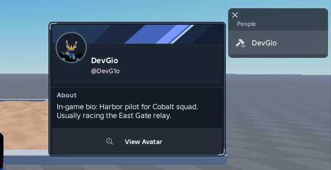

# Profile cards



Choose `Preset = "Profile"` in **Roster → Settings** for a social card with a cover, avatar, display name, @username and the usual avatar, friendship and block actions where available. The About section collapses when the player has no usable biography. Match stats and match actions are off by default. Developers can still supply their own columns and actions.

## Show a biography

The Roblox Open Cloud **Get User** endpoint can return the optional `User.about` field. It can omit it when empty or when the account's About visibility doesn't allow the caller to see it. The server calls this endpoint using the experience's own credential. Because that credential represents one caller, Pennant additionally requires the author to opt into displaying their account biography in the game. A separate fallback can show a player-authored bio saved by your game. [Get User and the User schema](https://create.roblox.com/docs/cloud/reference/features/users.md) · [In-experience HTTP](https://create.roblox.com/docs/cloud-services/http-service)

For Roblox account bios, enable **Allow HTTP Requests** in Experience Settings. Store an Open Cloud API key as an experience secret limited to `apis.roblox.com`. Reference its **secret name** from a server Script. Get User's basic public fields include the bio. This integration reads only the matching account ID and About field. Private user details and social-account links are outside its scope. [Roblox's Get User announcement](https://devforum.roblox.com/t/open-cloud-groups-api-users-api-beta/2909090) · [Experience secrets](https://create.roblox.com/docs/cloud-services/secrets)

Put this in a Script in **ServerScriptService** after installing Roster in ReplicatedStorage. Connect the player's affirmative sharing choice to your own server-managed settings. The service watches `PennantShareAccountBio` on each live Player. Revoking that choice immediately clears the displayed account biography. The game can then supply its separate experience bio.

```luau
local Roster = require(game:GetService("ReplicatedStorage"):WaitForChild("Roster"))
local service = Roster.ServeProfiles({ApiKeySecret = "PennantUsers"})

-- After the player chooses to display their account bio in this experience:
-- player:SetAttribute("PennantShareAccountBio", true)
-- When they turn it off:
-- player:SetAttribute("PennantShareAccountBio", false)
```

For game-authored profiles, supply `ReadBio(player)` from your trusted server data layer. This option works without HTTP, an API key or account-bio sharing. If you supply both options, an eligible account biography takes priority and the callback supplies the fallback. This example assumes your game already exposes its loaded player profiles in a server-only module.

```luau
local Roster = require(game:GetService("ReplicatedStorage"):WaitForChild("Roster"))
local PlayerProfiles = require(game:GetService("ServerStorage"):WaitForChild("PlayerProfiles"))
local service = Roster.ServeProfiles({
    ReadBio = function(player)
        local profile = PlayerProfiles.Get(player)
        return if profile then profile.PublicBio else nil
    end,
})
```

Pennant filters either source on the server under the player's own user ID, using `TextService:FilterStringAsync()` and `GetNonChatStringForBroadcastAsync()`. Only the filtered result is replicated. An error or empty result hides the section. Keep raw authored bios in server storage. Player-facing text-editing UI, submission limits and saving are the responsibility of the game that collects the text. [Roblox text filtering](https://create.roblox.com/docs/ui/text-filtering)

## Lifetime and display

- `Roster.ServeProfiles(options)` starts the service once on the server and returns its controller. It registers current players and new arrivals. Cards can open, close or scroll without issuing an HTTP request.
- `service:Refresh(player)` requests a fresh bio after game data changes. It returns `false` for an unavailable player or within 60 seconds of that player's previous refresh. The service runs at most two reads concurrently per server and clears stale text before publishing a newly filtered result.
- `service:Clear(player)` immediately clears the replicated biography and invalidates a lookup already in progress. `service:Destroy()` disconnects the listeners and clears all served bios.
- The section wraps plain text, disables rich-text markup and shows up to five lines from the first 300 Unicode code points. Larger text preferences get additional space. Private or missing account fields, provider errors, and failed moderation never display raw text.
